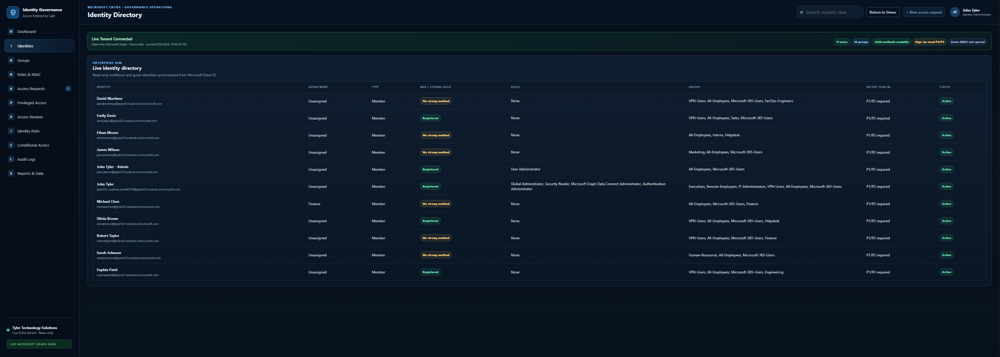

# Azure Identity Governance Console

A browser-based Microsoft Entra ID and Azure governance lab that combines a **simulated IAM operations console** with an optional **read-only Live Tenant connection**. It demonstrates identity lifecycle concepts, group and role governance, Azure RBAC, privileged access, access reviews, Conditional Access, audit activity, and permission-aware Microsoft cloud API integration.

> **Scope:** Personal, single-tenant IAM portfolio/lab project, not a production IAM management platform. The GitHub Pages link is **demo-only**: it uses sample data and does **not** allow Microsoft Entra authentication or live tenant connections. The separately hosted Azure Static Web Apps deployment supports a read-only live connection to the author's specifically configured Entra lab tenant. Simulated edits never write to Azure.

## Capabilities

| Area | Demo mode | Live Tenant mode |
| --- | --- | --- |
| Identities and groups | Sample records and simulated lifecycle edits | Read-only Entra directory and membership inventory |
| Microsoft Entra roles / PIM | Simulated governance workflows | Read-only directory-role and available PIM information |
| Azure RBAC | Simulated assignments | Read-only Azure Resource Manager assignment inventory when subscription access is permitted |
| Authentication posture | Sample metrics | Read-only registration/method data when Graph permissions permit |
| Conditional Access, audit and sign-ins | Sample governance views | Available live data subject to Graph permissions, licensing and API support |
| Access requests and reviews | Local workflow simulation | No writeback to the tenant |
| Governance intelligence | Model-based analysis | Client-side scoring, identity correlation and access-path analysis of retrieved data |

Unavailable, unauthorized, or unlicensed data is not evidence that a tenant has no findings. Inspect per-feature error or coverage indicators before interpreting results.

## Deployment

- **GitHub Pages:** [public interactive demo](https://johninfra.github.io/azure-identity-governance-console/) with fictional sample records only. `live-entra.js` explicitly disables live sign-in on `github.io` (and `file:`). Visitors cannot authenticate or connect any tenant from the Pages URL.
- **Azure Static Web Apps:** separate, tenant-specific live hosting path, configured to authenticate against the author's Entra lab tenant. Its optional **Connect Live Tenant** workflow requests delegated Microsoft Graph / Azure Resource Manager read access based on the signed-in identity and granted permissions; it does not support arbitrary outside tenants.
- **GitHub Actions:** deploys `main` to Azure Static Web Apps and runs static security checks. A successful deployment does not itself prove browser authentication or end-user authorization.

### Authentication and authorization — important distinction

The app uses **two distinct authentication mechanisms**:

1. **Application MSAL sign-in:** the browser obtains delegated Entra tokens for the configured lab tenant. Microsoft Graph and Azure Resource Manager evaluate requested scopes, tenant policies, and the **signed-in user's effective permissions** for each API call. A signed-in viewer must not be assumed to have the same data visibility as an administrator.
2. **Azure Static Web Apps hosted session:** `staticwebapp.config.json` configures an OIDC provider named `entra`, a route policy requiring the SWA `authenticated` role, and a login redirect. SWA's hosting session is **not interchangeable** with MSAL authentication. Earlier browser tests returned `{"clientPrincipal":null}` from `/.auth/me` even when the demo dashboard loaded, so effective hosting-route protection remains **unverified** and must not be presented as proven.

The formerly proposed custom SWA role `governance_reader` was **not deployed**; the merged security change restored the original `authenticated` route requirement. Azure subscription RBAC, Entra directory roles, Enterprise Application assignment, and SWA site roles are separate permission systems.

**Multi-organization support is not established.** The current `live-entra.js` connector uses a fixed tenant ID; users from arbitrary organizations cannot be assumed to authenticate and connect their own tenants. A multi-tenant app requires explicit registration, consent, tenant-isolation design, and adversarial testing.

### Required identity permissions

The Live Tenant connection uses a Microsoft Entra **single-page application (SPA)** registration with the applicable hosted redirect URI. The delegated Microsoft Graph scopes configured in the source are:

- `User.Read`
- `Directory.Read.All`
- `RoleManagement.Read.Directory`
- `AuditLog.Read.All`
- `UserAuthenticationMethod.Read.All`

Azure RBAC inventory additionally uses `https://management.azure.com/user_impersonation`. Some scopes require administrator consent and appropriate licensed capabilities. These scopes grant **delegated API access**, not elevated directory roles. Requests still depend on the signed-in user's privileges. No client secret belongs in SPA browser source code.

## Live Tenant data sources

Subject to permission, tenant licensing and API availability, the read-only connector can retrieve users and account status; department/UPN data; groups, memberships and owners; authentication methods; active directory roles and available PIM schedules; audit records; sign-in activity; and subscription-scoped Azure RBAC assignments.

The app uses HTTPS Microsoft Graph and Azure Resource Manager APIs. The security-hardening change restricts bearer-token requests to trusted API origins, rejects redirects and unexpected Graph pagination hosts, and uses MSAL session storage. Live data access must be tested using both privileged and limited-permission accounts.

**No live create, update, or delete operations are implemented.** Buttons and forms that modify sample identities, groups, roles, access requests, or risks affect the demonstration model, not Entra ID or Azure.

## Governance analysis

- **Governance Score:** application-defined heuristic; **not** Microsoft Secure Score.
- **Tenant Drift Detection:** compares in-memory snapshots during the current page lifecycle; previous live snapshots are no longer persisted to `localStorage`.
- **Identity 360:** correlates available identity, group, authentication, role and audit information.
- **Privilege Exposure Analyzer:** brings together observed directory roles, PIM and Azure RBAC paths.
- **Access Path Explorer:** visualizes direct and group-derived permissions without treating a visualization as an authorization decision.

## Data storage and privacy

The **demo model** uses browser-local `localStorage`, isolated by web origin; it is not a central, shared organizational database. Some non-secret connection identifiers may also be stored locally. Live drift snapshots remain in memory. Sensitive live directory information is processed in the browser and should not be treated as safe for unapproved corporate use simply because the app is read-only.

Do not commit tenant secrets, access tokens, passwords, production identity exports, or sensitive screenshots. A production system would need an approved backend/API, centralized audit and retention, carefully designed authorization, data minimization, and stronger runtime assurance.

## Security hardening and CI

Pull request [#3](https://github.com/johninfra/azure-identity-governance-console/pull/3) merged the October 2026 hardening work into `main`, including:

- Escaping and validation for multiple HTML rendering paths and security-action inputs.
- Delegated browser event handling instead of inline handlers in audited modules.
- HTTPS origin and redirect restrictions for live Graph/ARM bearer-token requests.
- Removal of persistent tenant drift snapshots.
- Security response headers and a **report-only** Content Security Policy.
- Automated JavaScript syntax and static security-invariant regression checks.

The [Static security checks](.github/workflows/security-checks.yml) workflow and Azure Static Web Apps CI/CD workflow passed on merge commit `88a751de2c76c15b8850f4c5b0f650090cb56762`. Static checks are **not** a penetration test, and a report-only CSP is **not** enforced.

### Runtime verification still required

Before treating hosting authentication or per-user data segregation as validated, test a new private-browser session against the actual Azure deployment: login and logout, `/.auth/me`, unauthorized requests, and role-appropriate Graph/ARM read visibility with admin and restricted test identities. Inspect browser console/network failures, verify stale demo data is clearly separated from live data, and test XSS and tenant isolation. Do not claim employer readiness or multi-tenant capability solely from successful CI.

See [Architecture](docs/ARCHITECTURE.md), [Deployment](docs/DEPLOYMENT.md), and [Security Model](docs/SECURITY.md) for the public-demo versus private live-tenant boundaries.

## Development

This is a static HTML/CSS/JavaScript project. Clone it, run a local static web server or open `index.html` for the demo, and use the GitHub Actions workflow for Azure deployment. Only connect your own authorized test tenant.

## Deployment evidence

A prior screenshot captures the console connected to the Tyler Technology Solutions Entra lab and displaying live identity and Azure authorization information. It documents a point-in-time test, not ongoing completeness or enterprise certification.

## Author

Built by John Tyler as an IAM, cloud administration and cybersecurity portfolio project.
